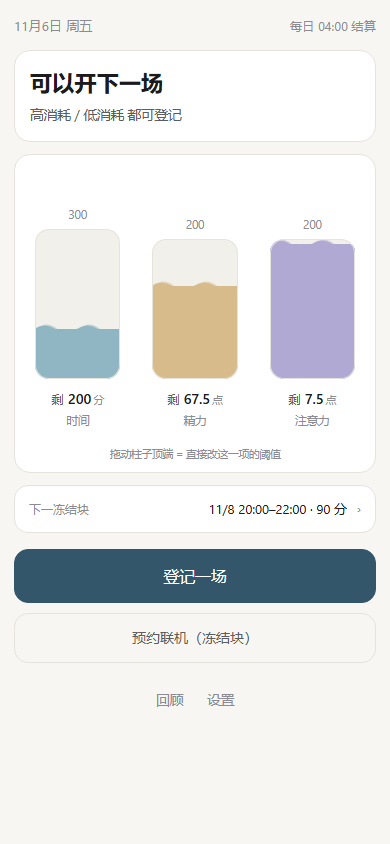
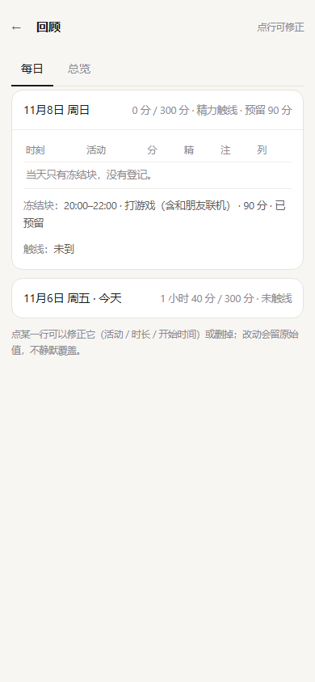
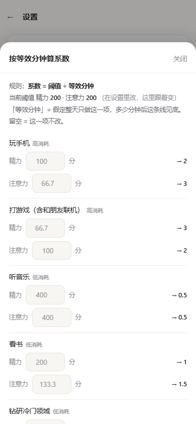
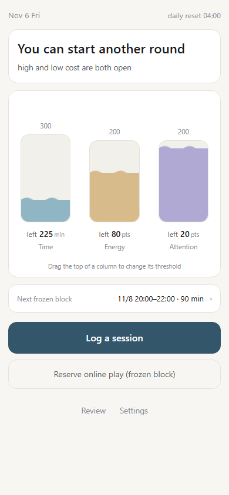

# 刻度 · 时间与注意力额度记账

> 备考时真正消耗人的，往往不是玩了多久，而是「我是不是已经玩太多了」这个念头一直在后台跑。
>
> 刻度想把那个念头变成一次查询：登记一次，之后不回看、不补记、不追评；打开只看结论，看完就能照做，不在现场做任何判断。
>
> 它的硬约束只有三条，前者否决后者：每日时间上限、精力与注意力双阈值、联机预约冻结块。上限由你自己定，程序不推荐数值、不加娱乐补时、不设成就与连续打卡。
>
> 界面是三根水位柱：柱高就是阈值，水位就是今天已经用掉的。没有登记时是空的。
>
> 它是刻度尺，不是监工。



**在线试用**：<https://twilightsunmoon-web.github.io/scale/>　·　**Android**：[下载 APK](../../releases/latest)

<p align="center"><sub>中文 / English · 首次打开选一次，之后在设置里改 · <a href="#english">English ↓</a></sub></p>

---

## 三条规则（前者否决后者）

| 优先级 | 规则 | 说明 |
|---|---|---|
| 1 | **每日时间上限** | 唯一的硬时间闸门。本地 **04:00** 结算，不结转、不补发、不累积 |
| 2 | **双阈值** | 精力分 = Σ(时长×精力系数)，注意力分 = Σ(时长×注意力系数)，各自独立阈值，任一触线即「该停」。只用于判断**能不能开下一场**，不中途熔断 |
| 3 | **预约冻结块** | 联机只能约在特定时段。冻结块绑在预约当日的额度上，一次划入，不占其他日期，也不要求今天先省着花 |

> **口径**：这里的「时间」指的是**工作与睡觉之外的闲置时间**（娱乐时间），不是一整天 24 小时。你设的「每日上限」是这段时间的长度。

触线 ≠ 不许玩。触线后高消耗项自动变灰，剩余时间只流向低消耗列，同时把预设动作顶出来：**起身倒水 → 正事只做开头 2 分钟**。

爽约的兜底在预约时就写死（顺延到下次窗口 / 直接归零），事后一键执行，不给你临场选的机会。

## 界面

三根水位柱：**柱高 = 阈值，水位 = 已占用**。没有登记时是空的；登记后按对应值上涨，水面是流动的波浪。拖动柱顶可以直接改阈值，不用进设置页。

<table>
<tr>
<td></td>
<td></td>
</tr>
</table>

- **回顾**：独立的只读入口，按日列出原始登记，可点开逐条修正或删除。改动会留下原始值，不静默覆盖。
- **总览**：近 7 天 / 30 天 / 全部，只呈现事实（每日占用、是否触线、高低消耗构成、冻结块与爽约计数），不给建议、不打分、不排名。

## 使用方式

**1. 直接打开**

下载 `index.html`，用浏览器打开即可。不需要联网，不加载任何外部资源。

> 注意：部分手机的文件管理器或聊天软件内置浏览器会屏蔽本地存储，表现为「关掉就没了」。这种情况改用下面两种方式。

**2. 安装 APK**（推荐，数据最稳）

到本仓库的 **Releases** 页面下载 `scale.apk` 安装。装好之后数据存在应用私有目录里，不会被浏览器清掉。

- 不需要任何权限，包括联网权限
- 导出 JSON 会写到系统「下载」文件夹

**3. 在线版（推荐分享这一条）**

<https://twilightsunmoon-web.github.io/scale/>

手机浏览器打开，菜单里选「添加到主屏幕」，用起来跟 App 一样。https 站点的本地存储是持久的，不会出现「关掉就没了」。

## 数据

- **全部在本地。** 没有账号、没有服务器、没有任何网络请求。
- 存储双写：`localStorage` + （APK 内）应用私有目录的 `state.json`。前者读不到时自动回退到后者。
- 设置里有：导出 JSON（含全部历史）、**导入 JSON**、清空历史（二次确认）、撤销上一次登记。
- 导入有两种：**合并**只补本机没有的记录（按 id 判重）；**覆盖**用文件里的刻度、预设和全部历史替换本机数据（界面语言保持不变）。换手机就靠这个。
- 每个活动登记时都会快照当时的系数与所属列，事后改预设表不会篡改历史记录。

## 自己构建 APK

需要 JDK 11+、curl、python。**不需要 Android Studio 或 Gradle**。

```bash
bash tools/build-apk.sh
```

首次运行会自动把 Android build-tools 与 platform 下到 `.sdk/`（约 120MB），产物在 `dist/scale.apk`。

签名密钥默认生成在 `tools/scale.keystore`（口令 `scale2026`）。**发布自己的版本时请换一个密钥，并且绝对不要把它提交到仓库**——它已经写进 `.gitignore`。

## 自定义

| 想改什么 | 在哪里 |
|---|---|
| 每日上限、两个阈值 | 首页拖动柱顶，或「设置 → 刻度」 |
| 每个活动的精力 / 注意力系数 | 「设置 → 活动预设表」，0–9 自由填，可带小数 |
| 不知道系数填多少 | 「设置 → 按等效分钟算系数」：系数 = 阈值 ÷「整天只做这一项，多少分钟后见底」 |
| 增加自己的活动 | 「设置 → ＋ 新增自定义事件」：填名字、选列，再填这一项「整天只做它、多少分钟见底」，系数当场算出（阈值 ÷ 分钟数）。存好即出现在登记列表里 |
| 白名单（不计入任何额度） | 把活动所属列改成「白名单」 |

## 已知限制

- 单机单用户，**没有云同步**（这是刻意的）。换设备需要导出 JSON 手动带走。
- 时长是你在开局前填的**预估**，不追踪真实使用，也不做自动计时。
- 历史按「开始日期」归属，跨零点的登记不拆分。

---

## English

**Scale** is a single-file, offline ledger for time and attention.



You log once before you start; it deducts time, energy and attention separately, then you close it. Next time it shows three numbers and one sentence: *you can start another round* — or *you're done for today*. No notifications, no scores, no streaks, no cloud.

It answers one question and stops there: **can I start another round?** It will not nag you, rate you, or talk you into "just five more minutes".

- **Live version:** <https://twilightsunmoon-web.github.io/scale/> — open on your phone and *Add to Home Screen*.
- One file. Open `index.html` in any browser, works offline, loads nothing external.
- Or install `scale.apk` from Releases — **no permissions at all, not even internet**.
- UI in Chinese and English; choose on first launch, change it any time in Settings.
- Your data stays on your device: `localStorage`, plus a private file in the Android build as a second copy. Export to JSON whenever you like, and **import** it back (merge by id, or replace everything) when you switch devices.

> **Scope:** "time" here means **idle time outside work and sleep** — leisure time, not a full 24-hour day. The daily cap you set is the length of *that* window.

Three rules, each overriding the one after it:

| # | Rule | What it means |
|---|---|---|
| 1 | **Daily time cap** | The only hard time gate. Resets at 04:00 local, no rollover |
| 2 | **Energy & attention thresholds** | Two independent point budgets; the first one hit decides whether the *next* session may start. Never cuts a session short |
| 3 | **Frozen blocks** | Online play can only happen in certain windows. A reservation is earmarked against that day's quota only, and a no-show is fixed in advance (postpone or void) |

*Blocks are gauges, not a supervisor.*

## License

[MIT](LICENSE)
